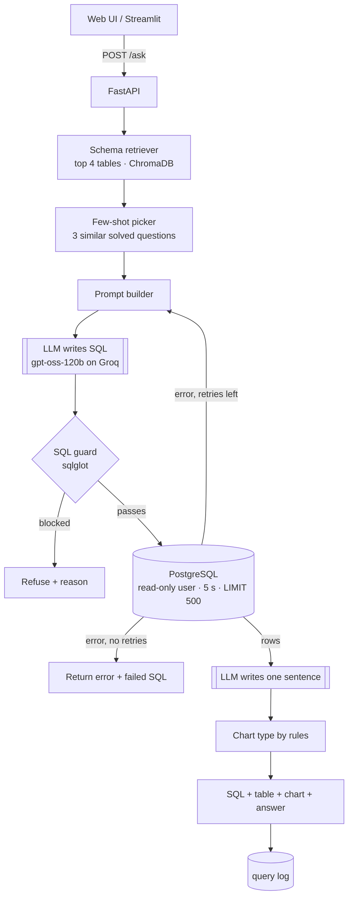

# AskDB

Ask a business question in plain English. AskDB finds the right tables, writes one
PostgreSQL query, runs it safely on the Olist e-commerce database, and answers with the
SQL, a result table, a chart and one sentence.

What makes it different from a demo: **accuracy is measured**. Every pipeline change is
scored on 100 hand-checked questions and logged in MLflow.

**New here?** Read the [guide](docs/GUIDE.md): the full flow, a worked example and the
kinds of questions you can ask.

> **Q:** Which 5 product categories earned the most revenue in 2017?
> **A:** Bed, bath & table led 2017 revenue at about R$4.9 lakh, just ahead of watches & gifts and health & beauty.
> _(Real figures from the data; the sentence is illustrative.)_

## Demo
_Live link and demo GIF go here._

Run it locally and open **http://localhost:8000** for the web UI: example questions, history,
a bar/line chart switcher, sortable results, CSV download and dark mode. A simpler
Streamlit page is at http://localhost:8501.

## Architecture



Only the two double-boxed steps call the LLM. Everything else is plain, unit-tested Python.
All logic lives in the `askdb/` package; the API, the UI and the eval script all call the
same `askdb.pipeline.ask()`.

## Results (execution accuracy on 100 questions)

| Configuration                      | Easy | Medium | Hard | Overall |
|------------------------------------|------|--------|------|---------|
| Baseline: full schema, zero-shot   | __%  | __%    | __%  | __%     |
| + schema retrieval                 | __%  | __%    | __%  | __%     |
| + few-shot examples                | __%  | __%    | __%  | __%     |
| + error-feedback retry             | __%  | __%    | __%  | __%     |

_Not run yet: fill in from `python -m eval.run_eval ...` (see below)._

**How it is scored.** Each question has a gold SQL query. A prediction is correct when it
returns the same rows as the gold query: rows are compared as multisets, numbers rounded
to 2 decimals, column names and column order ignored, and row order checked only for
ranking ("top 5") questions. Comparing results, not SQL text, means any correct query
counts. Tiers: 33 easy (one table), 40 medium (joins, GROUP BY, dates), 27 hard
(3+ joins, window functions, repeat customers, cohorts, growth, moving averages).

**No test-set leakage.** The 30 few-shot examples cover different questions from the
eval set; `tests/test_data_integrity.py` fails if any eval question or gold query shows up
in the bank.

## Safety: four layers

1. **sqlglot guard** parses the query into a tree: exactly one statement, SELECT only, no
   INSERT/UPDATE/DELETE/DDL/GRANT/SET/`SELECT INTO`/`FOR UPDATE` anywhere (including inside
   CTEs), only known tables.
2. **Read-only database role** `askdb_reader` has only `SELECT` grants, and every session
   is a read-only transaction.
3. **5-second statement timeout** on the role and on every connection.
4. **Row limit**: `LIMIT 500` is added when missing, and the executor stops reading at 500 rows.

Even if the guard had a bug, the database role cannot write.

## The data

[Olist Brazilian e-commerce](https://www.kaggle.com/datasets/olistbr/brazilian-ecommerce):
~100K orders (2016–2018), 9 tables. The traps (revenue = delivered orders only,
`customer_id` vs `customer_unique_id`, multiple payments per order, Portuguese category
names, duplicate geolocation rows) are documented in
[`data/schema_docs.yaml`](data/schema_docs.yaml), which is also what the model reads.
See [`notebooks/01_explore_olist.ipynb`](notebooks/01_explore_olist.ipynb).

## Run locally

```bash
python -m venv .venv && source .venv/bin/activate
pip install torch --index-url https://download.pytorch.org/whl/cpu   # optional: avoids CUDA downloads
pip install -r requirements.txt
cp .env.example .env                  # add your GROQ_API_KEY

# Olist CSVs from Kaggle go in data/raw/
docker compose up -d postgres         # creates tables + read-only role
python -m db.load_data                # CSVs -> PostgreSQL

uvicorn api.main:app --reload         # web UI + API on :8000, docs at /docs
streamlit run app/streamlit_app.py    # UI on :8501
# or everything in containers:
docker compose up --build
```

## Evaluate

```bash
python -m eval.run_eval --check-gold                        # validate gold SQL (no LLM)
python -m eval.run_eval                                     # baseline
python -m eval.run_eval --retrieval                         # + schema retrieval
python -m eval.run_eval --retrieval --fewshot               # + few-shot
python -m eval.run_eval --retrieval --fewshot --retries 2   # + error-feedback retry
mlflow ui --backend-store-uri sqlite:///mlflow.db           # compare runs
pytest -q                                                   # unit tests (no DB, no LLM)
```

Each run writes a per-question CSV and a failures file to `eval/results/`. On Groq's free
tier, pass `--sleep 3` if you hit rate limits.

## Tech stack

Python 3.11 · PostgreSQL 16 · SQLAlchemy + psycopg · Groq (`openai/gpt-oss-120b`, free tier, temperature 0) via
langchain-groq (chat call only) · sentence-transformers `all-MiniLM-L6-v2` · ChromaDB ·
sqlglot · FastAPI · plain HTML/JS web UI + Plotly.js · Streamlit + Plotly · MLflow · pytest · Docker Compose
