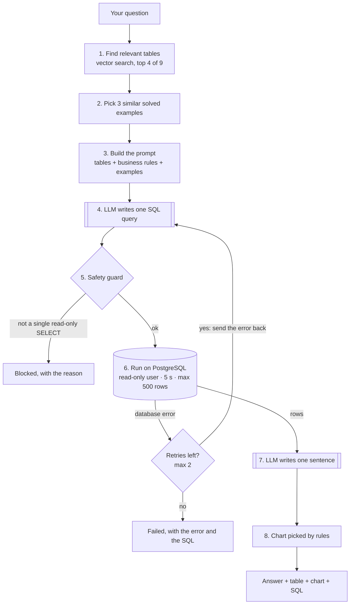

# AskDB guide: how it works and what you can ask

AskDB answers business questions about a Brazilian e-commerce marketplace (Olist) in
plain English. You type a question; AskDB writes the SQL, runs it safely, and replies with
**one sentence, a result table, a chart and the SQL it used**, so you can check its work.

- [Ways to use it](#ways-to-use-it)
- [The flow: what happens to your question](#the-flow-what-happens-to-your-question)
- [Worked example](#worked-example)
- [What data is there](#what-data-is-there)
- [Types of questions you can ask](#types-of-questions-you-can-ask)
- [Tips for good questions](#tips-for-good-questions)
- [What it cannot do](#what-it-cannot-do)
- [Reading the result](#reading-the-result)

---

## Ways to use it

| Way | Where | Best for |
|---|---|---|
| **Web UI** | http://localhost:8000 | Everyday use: example questions, history, chart switcher, CSV download, dark mode |
| Streamlit UI | http://localhost:8501 | A simpler alternative page |
| REST API | `POST http://localhost:8000/ask` (docs at `/docs`) | Calling AskDB from code |

Start everything with `docker compose up -d`, or locally with `uvicorn api.main:app`.

```bash
curl -s -X POST localhost:8000/ask -H 'Content-Type: application/json' \
     -d '{"question": "How many orders were placed each month in 2018?"}'
```

---

## The flow: what happens to your question



| Step | What happens | Why |
|---|---|---|
| 1. Find tables | The question is embedded (`all-MiniLM-L6-v2`) and compared with a description of each of the 9 tables stored in ChromaDB. The 4 closest are kept. | Sending only the relevant tables gives the model less noise and a smaller prompt. |
| 2. Examples | The 3 most similar questions from a bank of 30 solved question → SQL pairs are added. | Shows the model the house style: how revenue is computed, which joins to use. |
| 3. Prompt | Table columns, plain-English notes and business rules (from `data/schema_docs.yaml`) plus the examples. | The notes carry the data's traps, e.g. "a customer is `customer_unique_id`". |
| 4. Write SQL | `openai/gpt-oss-120b` on Groq, temperature 0. | Temperature 0 makes answers repeatable. |
| 5. Guard | The SQL is parsed with sqlglot: exactly one statement, SELECT only, no writes or schema changes anywhere (including inside sub-queries), only the 9 known tables. Adds `LIMIT 500` if missing. | First safety layer. |
| 6. Run | Runs as `askdb_reader`, a database user that can only read, inside a read-only transaction, with a 5-second timeout. | Second and third safety layers: even a guard bug cannot change data. |
| 6b. Self-correction | If Postgres returns an error (e.g. `column "price" does not exist`), the error and the failed SQL go back to the LLM, which tries again (at most 2 retries). | Fixes typos and wrong column names automatically. |
| 7. Answer | The LLM writes one sentence from the first 20 rows. | A quick human-readable summary. |
| 8. Chart | Simple rules, not the LLM: a date/month/year column → line chart; one text + one number column → bar chart; otherwise table only. | Predictable and free. |

Only steps 4 and 7 call the LLM. Everything else is ordinary, unit-tested Python.

---

## Worked example

**Question:** *Which 5 product categories earned the most revenue in 2017?*

1. **Tables found:** `products`, `category_translation`, `orders`, `order_items`.
2. **Rules that apply** (from the schema notes): revenue = `SUM(order_items.price)` over
   delivered orders; "in 2017" uses `order_purchase_timestamp`; category names must come
   from `category_translation` (the raw names are in Portuguese).
3. **SQL written:**
   ```sql
   SELECT t.product_category_name_english AS category,
          SUM(oi.price) AS revenue
   FROM order_items oi
   JOIN orders o ON o.order_id = oi.order_id
   JOIN products p ON p.product_id = oi.product_id
   JOIN category_translation t ON t.product_category_name = p.product_category_name
   WHERE o.order_status = 'delivered'
     AND EXTRACT(YEAR FROM o.order_purchase_timestamp) = 2017
   GROUP BY t.product_category_name_english
   ORDER BY revenue DESC
   LIMIT 5
   ```
4. **Guard:** one SELECT, known tables only, already has a LIMIT, so it passes unchanged.
5. **Result:** bed_bath_table R$490,597 · watches_gifts R$475,611 · health_beauty R$473,833 ·
   sports_leisure R$435,674 · computers_accessories R$391,786
6. **Chart:** one text column + one number column → **bar chart**.
7. **Answer:** "The five highest-revenue 2017 categories were bed_bath_table (R$491k),
   watches_gifts (R$476k), health_beauty (R$474k), sports_leisure (R$436k) and
   computers_accessories (R$392k)."

---

## What data is there

About 100,000 orders placed between **September 2016 and October 2018** (2016 and
Sep–Oct 2018 are almost empty). Money is in Brazilian reais (R$).

| Table | One row per | You can ask about |
|---|---|---|
| `orders` | order | order counts, status, purchase/approval/delivery dates, late deliveries |
| `order_items` | item in an order | revenue, prices, freight cost, items sold |
| `order_payments` | payment (an order can have several) | payment types, installments, amounts paid |
| `order_reviews` | review | 1–5 star scores, satisfaction |
| `customers` | customer *per order* | customer cities and states, unique and repeat customers |
| `products` | product | categories, weight, size, number of photos |
| `category_translation` | category | English category names |
| `sellers` | seller | seller cities and states |
| `geolocation` | zip prefix location | latitude/longitude (rarely needed) |

**Business rules AskDB follows:**
- **Revenue** = sum of item prices of **delivered** orders (freight not included).
- **A customer** = a real person (`customer_unique_id`). One person can have many orders.
- **"In 2017", "per month"** = by the date the order was placed.
- **Delivery time** = days from purchase to delivery to the customer.
- **Late** = delivered after the estimated delivery date.
- **Percentages** are 0–100.

---

## Types of questions you can ask

Every type below is covered by the 100-question evaluation set, so accuracy is measured
for each kind.

### 1. Counts and simple lookups
- How many orders are there in total?
- How many sellers are located in the state of SP?
- What is the highest price of a single order item?
- How many products have no category?

### 2. Breakdowns by a category
- List each order status with its number of orders.
- What is the total payment value for each payment type?
- What is the average review score for each customer state?

### 3. Top-N rankings
- Which 5 product categories earned the most revenue in 2017?
- Which 10 customer states have the most unique customers?
- Which 5 sellers sold the most order items?

### 4. Trends over time (month, quarter, year, weekday)
- How many orders were placed in each month of 2017?
- What was the revenue in each quarter of 2017?
- How many orders were placed on each day of the week in 2018?

### 5. Averages, medians and percentages
- What is the average delivery time in days for delivered orders?
- What is the median delivery time in days?
- What percentage of all orders have the status delivered?

### 6. Combining several tables
- Which 5 customer states generated the most revenue?
- What is the average freight value per item for each customer state?
- Which 3 product categories have the most items in canceled orders?

### 7. Customer behaviour (repeat customers, first orders, cohorts)
- How many repeat customers are there?
- What percentage of unique customers placed more than one order?
- For each month of 2017, how many new customers placed their first ever order?
- How much revenue came from repeat customers?

### 8. Growth, running totals and moving averages
- For each month of 2017, what was the growth in orders compared with the previous month?
- For each month of 2018, what is the cumulative revenue so far?
- Which 5 categories grew their revenue the most from 2017 to 2018?
- What is the 3-month moving average of revenue in 2017?

### 9. "Best in each group" and shares of a total
- For each customer state, which product category earned the most revenue?
- For each year, which 3 categories earned the most revenue?
- Which 5 seller states earned the largest share of total revenue?

### 10. Delivery performance
- What share of delivered orders arrived late in each year?
- Which 5 customer states have the longest average delivery time?
- What is the average review score of orders that arrived late?

---

## Tips for good questions

- **Name the time range:** "in 2017", "each month of 2018". Without one, AskDB uses all years.
- **Say what to show:** "Show the state and the revenue" gets exactly those columns.
- **Say how many:** "top 5", "which 3", rather than "the top ones".
- **Use the business words:** "revenue", "unique customers", "delivered orders",
  "late deliveries"; AskDB knows what they mean here.
- **One question at a time.** Each question is answered on its own; AskDB does not
  remember the previous one, so "and for 2018?" won't work. Ask the full question again.
- **Check the SQL.** It is always shown, so you can see exactly what was counted.

---

## What it cannot do

| Limitation | Why |
|---|---|
| Change data ("delete…", "update…") | Read-only by design: the guard blocks writes, and the database user has no write permission. |
| Answer questions outside the data | There is nothing after Oct 2018, and nothing about stock, marketing or profit margins (no cost data). |
| Forecast ("how many orders next year?") | It runs SQL on historical data; there is no prediction model. |
| Read review comments | Comments are free text in Portuguese; only scores are analysed reliably. |
| Return more than 500 rows | Results are capped at 500 rows to keep responses fast and safe. |
| Run very heavy queries | Anything taking over 5 seconds is cancelled. |
| Follow-up questions | Each question is independent (see tips). |

It can also simply be wrong, especially on vague or very complex questions. That is
exactly what the evaluation set measures (see the results table in the [README](../README.md)).

---

## Reading the result

| Status | Meaning | What you see |
|---|---|---|
| **answered** | The SQL ran. | Sentence, table, chart (when the shape allows), SQL, attempts and time taken. |
| **blocked** | The safety guard refused the SQL (not a single read-only SELECT, or an unknown table). | The reason and the SQL that was refused. Nothing ran. |
| **failed** | The database kept returning errors after 2 retries, or the LLM was unreachable. | The error and the last SQL tried. |

**Attempts > 1** means the self-correction loop fixed an error. The time taken is mostly
the LLM thinking (around 3–15 seconds per question).
